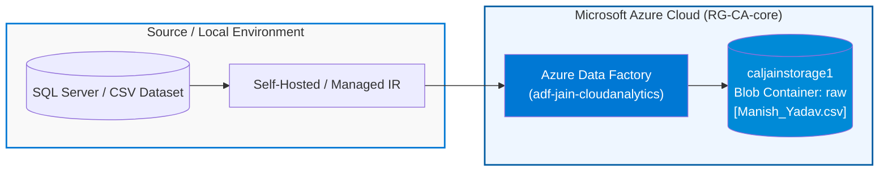
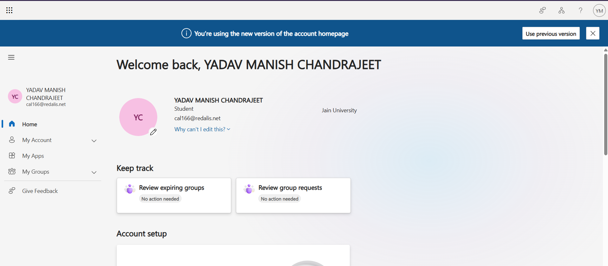
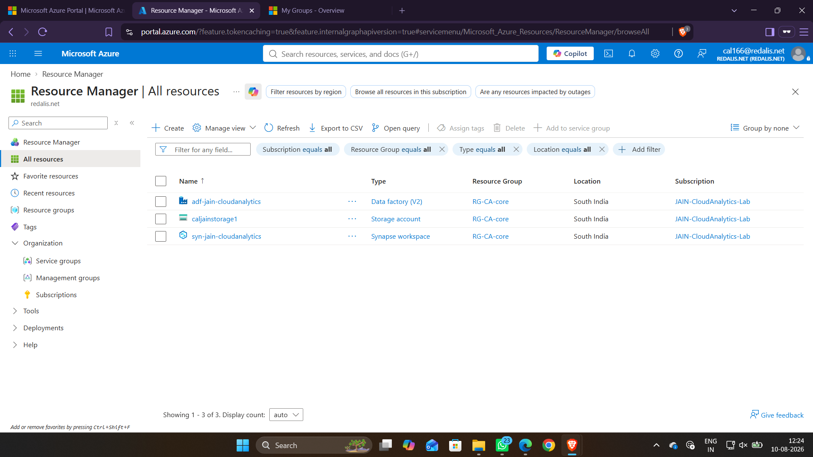
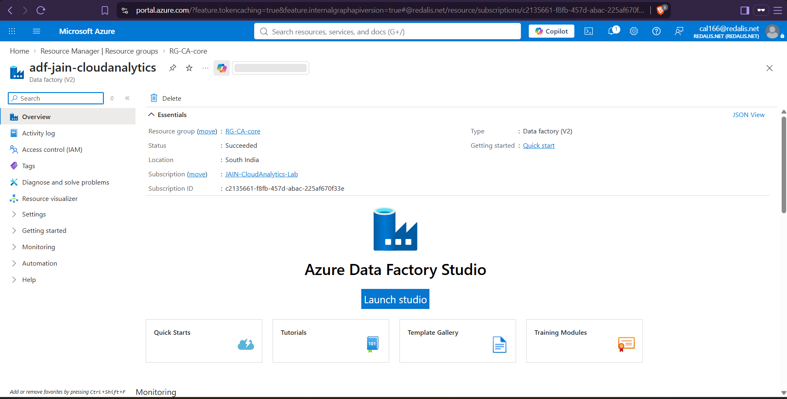
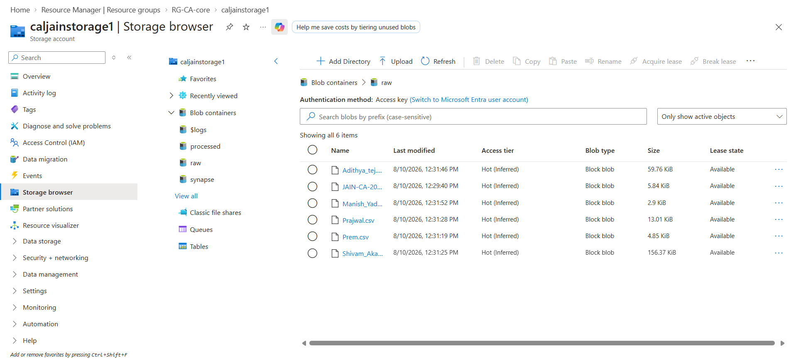

# Experiment 01: ADF Pipeline — On-Prem SQL / Ingestion to Azure Blob Storage

---

## 🎯 Aim & Objectives
To configure and execute an ingestion workflow using **Microsoft Azure Data Factory (ADF)** to transfer datasets from an on-premises / source environment into **Azure Blob Storage (ADLS Gen2)**, establishing a secure hybrid data foundation for cloud analytics.

---

## 📖 Theoretical Background
**Azure Data Factory (ADF)** is a fully managed, serverless cloud data integration and orchestration service. It allows data engineers to create data-driven workflows (pipelines) for ingesting data from disparate sources (on-premises SQL databases, SaaS platforms, cloud buckets) and landing it into centralized cloud data lakes.

In enterprise data architectures:
1. **Self-Hosted Integration Runtime (SHIR)** bridges on-premises infrastructure and the Azure cloud securely without opening inbound firewall ports.
2. **Azure Data Lake Storage Gen2 (ADLS Gen2)** provides high-throughput storage, hierarchical namespaces, and granular access control for downstream processing.

---

## 🏗️ Architecture & Data Flow

---

## ⚙️ Environment & Resource Specifications

| Parameter | Configuration / Resource Name |
| :--- | :--- |
| **Student / Operator** | Yadav Manish Chandrajeet (`cal166@redalis.net`) |
| **Institution** | Jain University |
| **Azure Subscription** | `JAIN-CloudAnalytics-Lab` (`c2135661-f8fb-457d-abac-225af670f33e`) |
| **Resource Group** | `RG-CA-core` |
| **Deployment Region** | `South India` |
| **Data Factory Instance** | `adf-jain-cloudanalytics` |
| **Storage Account** | `caljainstorage1` |
| **Target Container / Path** | `raw/Manish_Yadav.csv` |

---

## 🛠️ Step-by-Step Implementation Procedure

### Step 1: Azure Tenant Authentication & Environment Verification
- Log in to the Microsoft Azure Portal using the institutional tenant account (`cal166@redalis.net`).
- Confirm valid subscription quotas and group membership under Jain University Cloud Analytics Lab.

### Step 2: Resource Group & Infrastructure Provisioning
- Access **Resource Manager** $\rightarrow$ **Resource Groups**.
- Verify that resource group `RG-CA-core` is active with associated instances (`adf-jain-cloudanalytics`, `caljainstorage1`, and `syn-jain-cloudanalytics`).

### Step 3: Azure Data Factory Studio Initialization
- Navigate to the `adf-jain-cloudanalytics` resource overview.
- Launch the **Azure Data Factory Studio** workspace to configure data movement pipelines, linked services, and datasets.

### Step 4: Storage Account & Raw Data Ingestion Setup
- Navigate to Storage Account `caljainstorage1` $\rightarrow$ **Storage browser** $\rightarrow$ **Blob containers**.
- In the `raw` container, verify data ingestion and upload of the lab student dataset: `Manish_Yadav.csv` (Size: `2.9 KiB`, Access Tier: `Hot`).

---

## 📸 Visual Evidence (Proof of Work)

### 1. Azure Tenant Login & Identity Verification
> Successful authentication to the Microsoft Azure tenant with user profile `Yadav Manish Chandrajeet`.

---

### 2. Azure Resource Group (`RG-CA-core`) Infrastructure
> Overview of core deployed cloud resources within the `South India` region.

---

### 3. Azure Data Factory Studio Workspace
> ADF instance `adf-jain-cloudanalytics` ready for pipeline orchestration and data flows.

---

### 4. Storage Container (`raw`) with Ingested Dataset
> Verification of `Manish_Yadav.csv` stored in the `raw` container within storage account `caljainstorage1`.

---

## 📊 Results & Conclusion
- Successfully provisioned and verified Microsoft Azure cloud data engineering resources under `RG-CA-core`.
- The dataset `Manish_Yadav.csv` was ingested into the `raw` blob container in `caljainstorage1`, forming the input data lake layer for downstream integration and linked service connectivity in Experiment 02.
