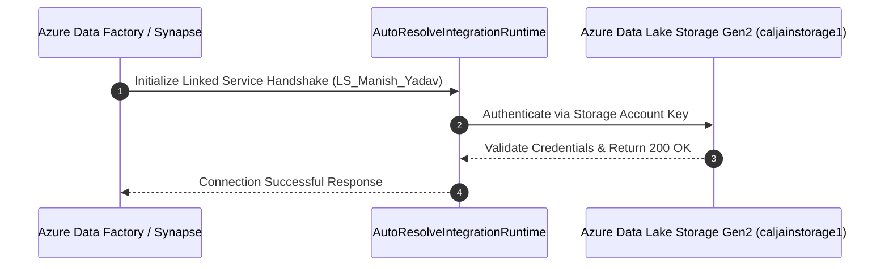
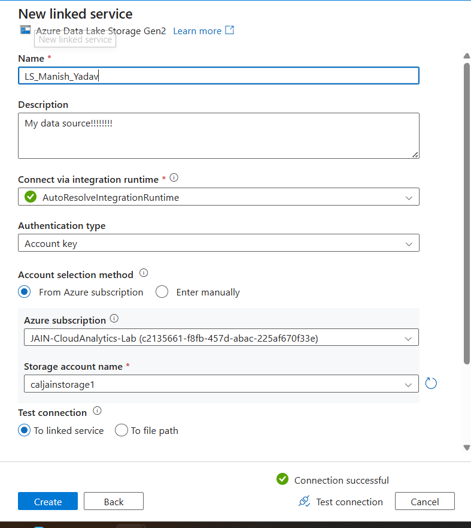

# Experiment 02: Linked Service Configuration to Azure Data Lake Storage (ADLS Gen2)

---

## 🎯 Aim & Objectives
To create, configure, and validate a secure **Linked Service** connection (`LS_Manish_Yadav`) in Azure Data Factory / Synapse targeting **Azure Data Lake Storage Gen2 (`caljainstorage1`)** utilizing the `AutoResolveIntegrationRuntime` and Account Key authentication.

---

## 📖 Theoretical Background
In Azure Data Factory and Azure Synapse Analytics:
- A **Linked Service** acts as a connection string definition that defines the connection parameters (endpoint URL, credentials, authentication mechanism) required to communicate with external data stores or compute targets.
- An **Integration Runtime (IR)** provides the compute infrastructure used by ADF/Synapse to execute data movement activities, dispatch data flows, and execute external compute tasks.
- **AutoResolveIntegrationRuntime** dynamically routes and manages data movement within the Azure backbone network with automatic scalability and low latency.

---

## 🏗️ Architecture & Connectivity Workflow

---

## ⚙️ Linked Service Configuration Specifications

| Property Field | Configured Value |
| :--- | :--- |
| **Linked Service Name** | `LS_Manish_Yadav` |
| **Description** | `My data source!!!!!!!!` |
| **Type** | `Azure Data Lake Storage Gen2` |
| **Integration Runtime** | `AutoResolveIntegrationRuntime` |
| **Authentication Type** | `Account key` |
| **Account Selection Method** | `From Azure subscription` |
| **Azure Subscription** | `JAIN-CloudAnalytics-Lab (c2135661-f8fb-457d-abac-225af670f33e)` |
| **Storage Account Name** | `caljainstorage1` |
| **Test Connection Scope** | `To linked service` |
| **Validation Result** | `Connection successful` |

---

## 🛠️ Step-by-Step Implementation Procedure

### Step 1: Navigate to the Manage Hub
- Open **Azure Data Factory Studio** / **Synapse Studio**.
- Navigate to the **Manage** hub (wrench icon) from the left navigation panel.
- Under **Connections**, select **Linked services** and click **+ New**.

### Step 2: Select Data Store Connector
- In the *New linked service* gallery, search for **Azure Data Lake Storage Gen2**.
- Click **Continue**.

### Step 3: Configure Connection Parameters
- Set **Name** to `LS_Manish_Yadav`.
- Add an operational description.
- Select the `AutoResolveIntegrationRuntime` under **Connect via integration runtime**.
- Under **Authentication type**, choose `Account key`.
- Select `From Azure subscription`, pick the active subscription `JAIN-CloudAnalytics-Lab`, and choose storage account `caljainstorage1`.

### Step 4: Validate Connection
- Click **Test connection** (`To linked service`).
- Verify that Azure returns a green checkmark indicating **Connection successful**.
- Click **Create** and **Publish all** to save the linked service definition.

---

## 📸 Visual Evidence (Proof of Work)

### 1. Linked Service Configuration & Successful Connection Test
> Configuration modal of `LS_Manish_Yadav` showing validated connection to storage account `caljainstorage1`.

---

## 📊 Results & Conclusion
- Successfully established and verified the linked service `LS_Manish_Yadav` between Azure Data Factory / Synapse and the ADLS Gen2 storage account `caljainstorage1`.
- This linked service serves as the authenticated pipeline connector for reading raw datasets and executing analytical transformations in downstream pipelines.
