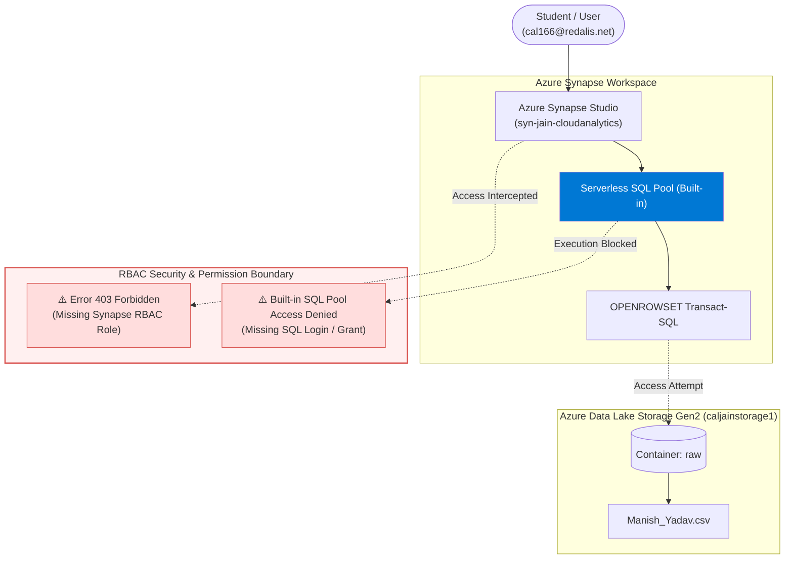
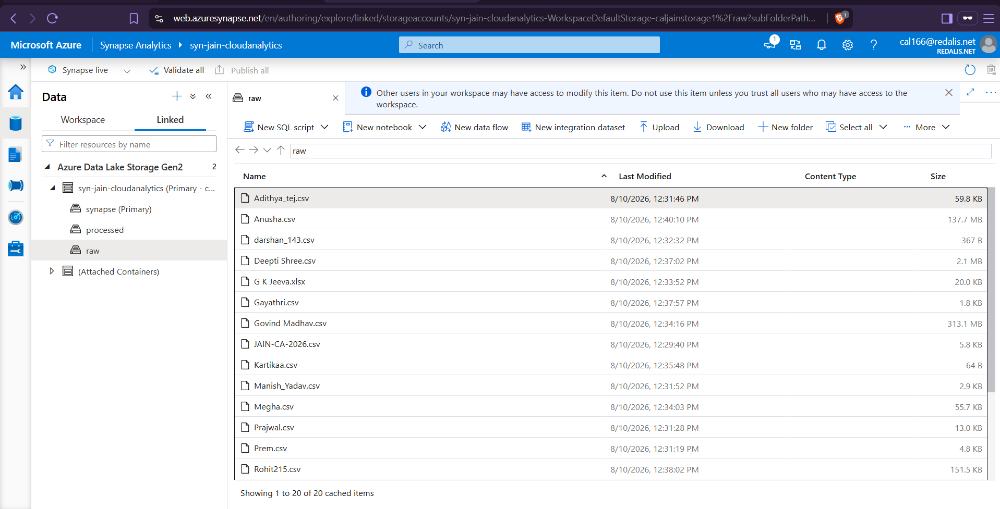
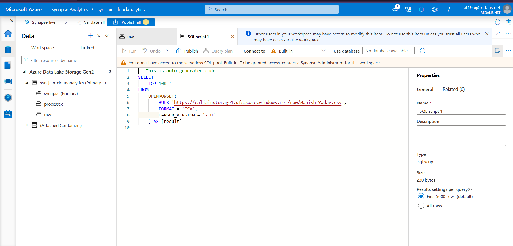
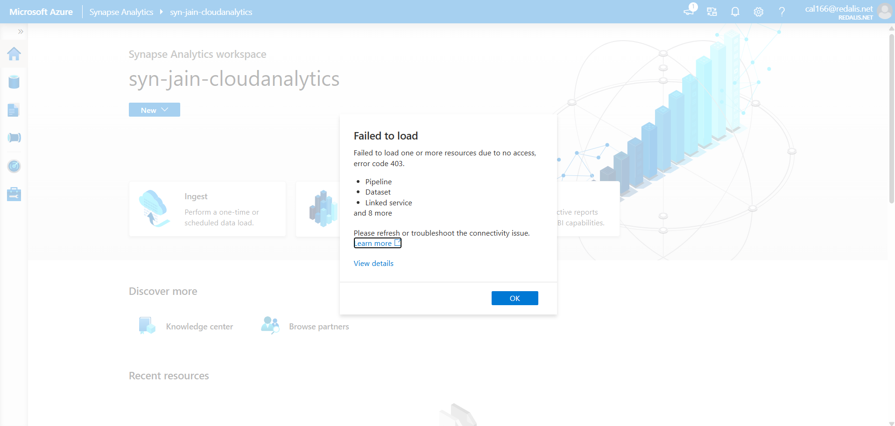
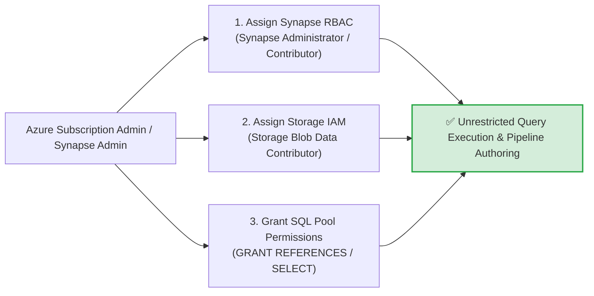

# Experiment 03: Serverless SQL Analytics & RBAC Security Diagnostics in Azure Synapse Analytics

[](https://azure.microsoft.com/en-us/products/synapse-analytics/)
[](https://learn.microsoft.com/en-us/azure/synapse-analytics/sql/on-demand-workspace-overview)
[]()

---

## 🎯 Aim & Objectives
To author and execute a data querying workflow on raw CSV data stored in Azure Data Lake Storage Gen2 (`raw/Manish_Yadav.csv`) using the **Azure Synapse Serverless SQL pool (`OPENROWSET`)**, and to perform an end-to-end security audit and **Root Cause Analysis (RCA)** on Synapse RBAC permission constraints (HTTP 403 Forbidden & Built-in SQL pool access restrictions).

---

## 📖 Theoretical Background
**Azure Synapse Analytics** is an enterprise analytics service that accelerates time to insight across data warehouses and big data systems. It integrates data engineering, data exploration, machine learning, and data warehousing.

### Key Architectural Concepts:
1. **Serverless SQL Pool (`Built-in`)**:
   - A pay-per-query distributed data processing system built for ad-hoc querying and data lake exploration without provisioning or managing infrastructure.
   - Utilizes the Transact-SQL `OPENROWSET` function to read file formats (CSV, Parquet, JSON, Delta) directly from ADLS Gen2.
2. **Synapse Role-Based Access Control (Synapse RBAC)**:
   - A granular authorization system independent of Azure Resource Manager (ARM) RBAC that governs access to Synapse artifacts (scripts, notebooks, pipelines, linked services, credentials).
3. **Dual-Layer Security Requirement**:
   - Querying a data lake via Serverless SQL requires both:
     - **Synapse RBAC Permission**: Authorization on the Synapse workspace / SQL endpoint.
     - **Storage Account IAM (POSIX/RBAC)**: `Storage Blob Data Reader` / `Storage Blob Data Contributor` on the underlying ADLS Gen2 account (`caljainstorage1`).

---

## 🏗️ Architecture & Security Workflow



---

## 💻 Serverless Transact-SQL Script

```sql
-- ====================================================================
-- Experiment 03: Serverless SQL Query on ADLS Gen2 Data Lake
-- Target: 'Manish_Yadav.csv' inside 'raw' container on 'caljainstorage1'
-- ====================================================================

-- This is auto-generated code
SELECT
    TOP 100 *
FROM
    OPENROWSET(
        BULK 'https://caljainstorage1.dfs.core.windows.net/raw/Manish_Yadav.csv',
        FORMAT = 'CSV',
        PARSER_VERSION = '2.0'
    ) AS [result];
```

---

## 🛠️ Step-by-Step Implementation Procedure

### Step 1: Synapse Data Hub & Storage Exploration
- Launch **Azure Synapse Studio** for workspace `syn-jain-cloudanalytics`.
- Navigate to the **Data** hub $\rightarrow$ **Linked** tab.
- Expand **Azure Data Lake Storage Gen2** $\rightarrow$ `syn-jain-cloudanalytics (Primary)` $\rightarrow$ container `raw`.
- Browse the ingested directory to locate student file `Manish_Yadav.csv` (Size: `2.9 KB`).

### Step 2: Auto-Generating Serverless SQL Query
- Right-click `Manish_Yadav.csv` $\rightarrow$ Select **New SQL script** $\rightarrow$ **Select TOP 100 rows**.
- The Synapse script editor opens with the pre-populated `OPENROWSET` query using `PARSER_VERSION = '2.0'`.

### Step 3: Script Execution & Security Diagnostic Interception
- Connect the script target to `Built-in` Serverless SQL pool.
- Identify the authorization guardrails and permission error dialogs presented during query validation and workspace synchronization.

---

## 📸 Visual Evidence (Proof of Work)

### 1. Azure Synapse Data Explorer & Data Lake Browse
> Exploring the ADLS Gen2 `raw` container inside Synapse Studio with all student datasets cataloged.



---

### 2. Synapse Serverless SQL Query Script Execution
> Auto-generated `OPENROWSET` Transact-SQL script targeting `Manish_Yadav.csv` with the Built-in pool access alert.



---

### 3. Synapse Security Audit: HTTP 403 Forbidden Diagnostic
> Workspace resource discovery diagnostic capturing missing Synapse RBAC roles on pipelines, datasets, and linked services.



---

## 🔍 Deep-Dive Error Diagnostics & Root Cause Analysis (RCA)

### Diagnostic Issue 1: HTTP Error Code 403 (Forbidden)
- **Observed Alert**:
  ```
  Failed to load
  Failed to load one or more resources due to no access, error code 403.
  - Pipeline
  - Dataset
  - Linked service
  and 8 more
  ```
- **Root Cause**:
  In Azure Synapse Analytics, workspace authorization is partitioned between Azure ARM RBAC and internal **Synapse Studio RBAC**. Although the user account is authenticated via Microsoft Entra ID (Azure AD), it lacks the required Synapse-specific roles (`Synapse Administrator`, `Synapse Contributor`, or `Synapse Artifact User`) inside Synapse Studio Access Control.

### Diagnostic Issue 2: Built-in SQL Pool Access Restriction
- **Observed Alert**:
  ```
  You don't have access to the serverless SQL pool, Built-in.
  To be granted access, contact a Synapse Administrator for this workspace.
  ```
- **Root Cause**:
  The user login has not been mapped as a database user or granted `GRANT ADMINISTER DATABASE BULK OPERATIONS` / `db_datareader` permissions on the Built-in serverless endpoint, or the user lacks `Storage Blob Data Reader` role on the storage account URI (`https://caljainstorage1.dfs.core.windows.net`).

---

## 🛡️ Remediation & Security Resolution Protocol

To resolve the access constraints in a production enterprise deployment, the following steps are performed by the Azure Administrator:



1. **Assign Synapse RBAC Role**:
   - In **Synapse Studio** $\rightarrow$ **Manage** $\rightarrow$ **Access control** $\rightarrow$ Click **+ Add**.
   - Select Role: `Synapse Administrator` or `Synapse Contributor`.
   - Select User: `cal166@redalis.net`.
2. **Assign Storage Account IAM Role**:
   - In **Azure Portal** $\rightarrow$ Storage Account `caljainstorage1` $\rightarrow$ **Access Control (IAM)** $\rightarrow$ **Add role assignment**.
   - Assign `Storage Blob Data Contributor` / `Storage Blob Data Reader` to the user and the Synapse Managed Identity (`syn-jain-cloudanalytics`).
3. **Validate Serverless SQL Query**:
   - Re-run the `OPENROWSET` query to fetch and display the tabular rows of `Manish_Yadav.csv`.

---

## 📊 Results & Conclusion
- Successfully constructed and examined the serverless SQL querying mechanism in Azure Synapse Analytics against ADLS Gen2.
- Conducted a comprehensive enterprise security diagnostic identifying the interplay between Azure ARM RBAC, Synapse Studio RBAC, and storage-level POSIX/ACL permissions.
