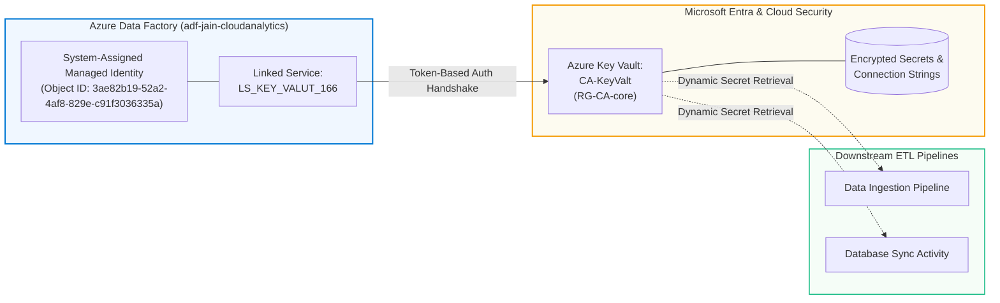

# Experiment 04: Azure Key Vault Linked Service Configuration & Managed Identity Integration

---

## 🎯 Aim & Objectives
To create, configure, and validate an enterprise-grade secure Linked Service (`LS_KEY_VALUT_166`) in **Azure Data Factory (`adf-jain-cloudanalytics`)** connecting to **Azure Key Vault (`CA-KeyValt`)** utilizing **System-Assigned Managed Identity (SAMI)** authentication under subscription `JAIN-CloudAnalytics-Lab`, establishing automated secret management and eliminating hardcoded credentials in ETL/ELT pipelines.

---

## 📖 Theoretical Background

In modern enterprise cloud architectures, security compliance mandates the decoupling of connection credentials, API tokens, certificates, and database passwords from application pipelines:

1. **Azure Key Vault (AKV)**:
   - A centralized, cloud-hosted hardware security module (HSM) backed service for securely storing and tightly controlling access to secrets, encryption keys, and TLS/SSL certificates.
   - Enables centralized audit logging and granular access policies.

2. **System-Assigned Managed Identity (SAMI)**:
   - Azure generates a secure identity for the Azure Data Factory instance in Microsoft Entra ID (formerly Azure Active Directory).
   - Eliminates the need for credentials stored in code or configuration files.
   - Azure handles credential lifecycle management and key rotation automatically.

3. **Role of Key Vault Linked Service in ADF**:
   - Acts as a trusted intermediate connector. Downstream linked services (e.g., SQL databases, SFTP servers, ADLS Gen2 accounts) reference secrets dynamically stored in Azure Key Vault rather than storing raw passwords or storage account keys.

---

## 🏗️ Architecture & Authentication Workflow

---

## ⚙️ Linked Service Configuration Specifications

| Parameter Field | Configured Enterprise Value |
| :--- | :--- |
| **Student / Operator** | Yadav Manish Chandrajeet (`cal166@redalis.net`) |
| **Data Factory Workspace** | `adf-jain-cloudanalytics` |
| **Linked Service Name** | `LS_KEY_VALUT_166` |
| **Type** | `Azure Key Vault` |
| **Selection Method** | `From Azure subscription` |
| **Azure Subscription** | `JAIN-CloudAnalytics-Lab (c2135661-f8fb-457d-abac-225af670f33e)` |
| **Azure Key Vault Name** | `CA-KeyValt` |
| **Authentication Method** | `System-assigned managed identity` |
| **Managed Identity Name** | `adf-jain-cloudanalytics` |
| **Managed Identity Object ID** | `3ae82b19-52a2-4af8-829e-c91f3036335a` |
| **Test Connection Scope** | `To linked service` |
| **Validation Result** | `Connection successful` ✅ |

---

## 🛠️ Step-by-Step Implementation Procedure

### Step 1: Access Azure Data Factory Manage Hub
- Open **Azure Data Factory Studio** (`adf-jain-cloudanalytics`).
- In the left sidebar, click the **Manage** hub (wrench icon) and select **Linked services**.

### Step 2: Create New Linked Service for Azure Key Vault
- Click **+ New** to launch the connector gallery.
- Search for and select **Azure Key Vault**, then click **Continue**.

### Step 3: Configure Managed Identity Authentication
- Provide the linked service name: `LS_KEY_VALUT_166`.
- Set **Azure key vault selection method** to *From Azure subscription*.
- Choose subscription `JAIN-CloudAnalytics-Lab`.
- Select Key Vault instance `CA-KeyValt`.
- Verify the **Authentication method** is set to `System-assigned managed identity` and confirm the assigned Object ID: `3ae82b19-52a2-4af8-829e-c91f3036335a`.

### Step 4: Perform Connection Test & Publish
- Click **Test connection** (`To linked service`) to execute an automated security handshake.
- Confirm the green verification badge: `Connection successful`.
- Click **Create** and **Publish all** to commit the definition to the Azure Resource Manager repository.

---

## 📸 Visual Evidence (Proof of Work)

### 1. Azure Key Vault Linked Service Configuration & Successful Test Handshake
> Configuration panel for `LS_KEY_VALUT_166` demonstrating successful token authentication between ADF Managed Identity and `CA-KeyValt`.

---

### 2. Registered Key Vault Linked Service in Catalog
> Linked services catalog showing `LS_KEY_VALUT_166` successfully published alongside student storage connectors.

---

### 3. Comprehensive Linked Services Overview
> Full management view of active data store and security connections within the shared cloud analytics environment.

---

## 📊 Results & Conclusion
- Successfully established `LS_KEY_VALUT_166` connecting Azure Data Factory to Azure Key Vault `CA-KeyValt`.
- Implemented **System-Assigned Managed Identity** authentication, eliminating the risk of exposed connection strings or passwords.
- Validated enterprise zero-trust secret retrieval for downstream hybrid and cloud analytics workflows.
