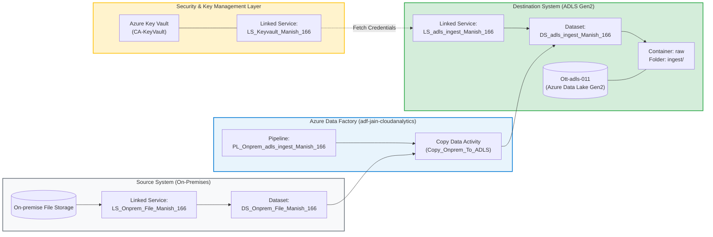
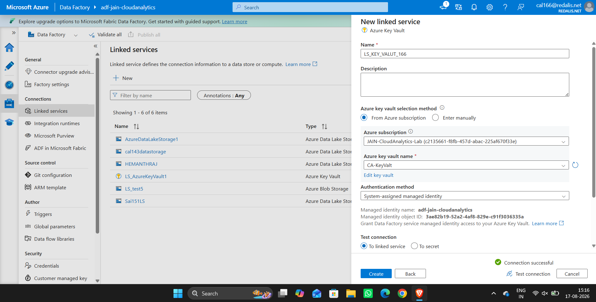
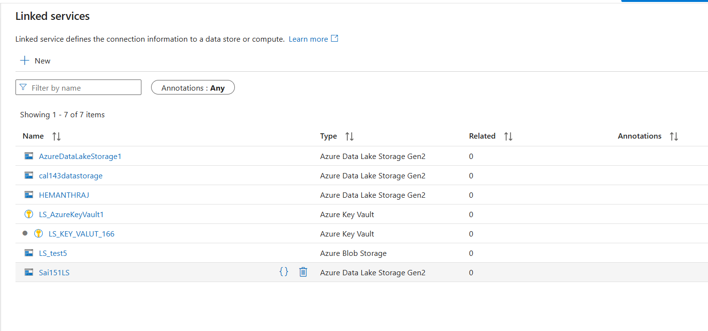
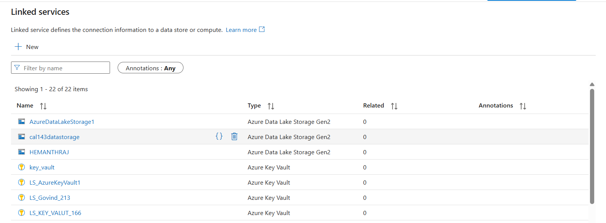

# Experiment 04: Hybrid Data Ingestion Pipeline — On-Premises Storage to Azure Data Lake Storage Gen2 (`PL_Onprem_adls_ingest_Manish_166`)

[](https://azure.microsoft.com/en-us/products/data-factory/)
[](https://azure.microsoft.com/en-us/products/key-vault/)
[](https://azure.microsoft.com/en-us/products/storage/data-lake-storage/)
[]()

---

## 🎯 Aim & Objectives
To construct, configure, and orchestrate a hybrid cloud data ingestion pipeline (**`PL_Onprem_adls_ingest_Manish_166`**) in **Azure Data Factory (ADF)** that securely transfers data from an **On-premises File Storage** environment into an **Azure Data Lake Storage Gen2** instance (**`Ott-adls-011`**), writing to the container path **`raw/ingest`**, with credentials securely managed via **Azure Key Vault (`LS_Keyvault_Manish_166`)**.

---

## 📖 Theoretical Background

In modern enterprise data architecture, hybrid data ingestion relies on three essential pillars:

1. **Hybrid Infrastructure Integration (Self-Hosted Integration Runtime)**:
   - On-premises file storage and internal database servers operate behind corporate firewalls.
   - ADF uses a **Self-Hosted Integration Runtime (SHIR)** agent to establish outbound-only encrypted communication with Azure without requiring inbound firewall openings.

2. **Secrets & Identity Management (Azure Key Vault Integration)**:
   - Storing database passwords, storage keys, or connection strings in plain text within data integration pipelines violates enterprise security standards.
   - Azure Data Factory connects to **Azure Key Vault (`LS_Keyvault_Manish_166`)** using **System-Assigned Managed Identity**. ADF fetches connection credentials dynamically at runtime without exposing secrets.

3. **Data Lake Ingestion Layer (ADLS Gen2)**:
   - Target storage account **`Ott-adls-011`** utilizes Azure Data Lake Storage Gen2 hierarchical namespaces.
   - Raw ingested files are landed in container `raw` under folder `ingest` for downstream ETL/ELT processing in Azure Synapse or Databricks.

---

## 🏗️ Architecture & Data Ingestion Flow



---

## ⚙️ Resource & Pipeline Specifications

| Service / Component | Name in Pipeline (`Manish_166`) | Description / Configuration Path | Validation Status |
| :--- | :--- | :--- | :---: |
| **Virtual Machine** | `VM-166-Manish` | On-Premises File Server Host (Windows Server 2019) | `Provisioned` ✅ |
| **Integration Runtime** | `SelfHostedIntegrationRuntime_Manish_166` | Self-Hosted IR Agent installed on `VM-166-Manish` | `Configured` ✅ |
| **Pipeline** | `PL_Onprem_adls_ingest_Manish_166` | Data Movement Orchestration Pipeline | `Configured` ✅ |
| **Source Linked Service** | `LS_Onprem_File_Manish_166` | On-Premises File Server Connector via SHIR | `Configured` ✅ |
| **Source Dataset** | `DS_Onprem_File_Manish_166` | Binary / DelimitedText Source File | `Configured` ✅ |
| **Security Linked Service** | `LS_Keyvault_Manish_166` | Azure Key Vault (`CA-KeyVault`) Managed Identity | `Verified` ✅ |
| **Target Storage Account** | `caljainstorage1` / `Ott-adls-011` | Azure Data Lake Storage Gen2 Instance | `Provisioned` ✅ |
| **Destination Linked Service** | `LS_adls_ingest_Manish_166` | ADLS Gen2 Connector with Account Key / AKV | `Configured` ✅ |
| **Destination Dataset** | `DS_adls_ingest_Manish_166` | Target Dataset (`raw/ingest`) | `Configured` ✅ |
| **Target Container** | `raw` | Primary Storage Container | `Active` ✅ |
| **Target Folder** | `ingest` | Landing Directory Path | `Active` ✅ |

---

## 🖥️ Virtual Machine & Self-Hosted Integration Runtime (SHIR) Setup

### Step A: Provision Windows Virtual Machine (`VM-166-Manish`)
1. In Azure Portal, search for **Virtual machines** $\rightarrow$ Click **+ Create** $\rightarrow$ **Azure virtual machine**.
2. **Resource Group**: `RG-CA-core`.
3. **Virtual machine name**: `VM-166-Manish`.
4. **Region**: `South India` (or `Central India`).
5. **Image**: `Windows Server 2022 Datacenter - x64 Gen2`.
6. **Size**: `Standard_B2s` / `Standard_B1s` (Low-cost B-series burstable VM ~$11-$14/month).
7. **OS Disk Type**: `Standard_LRS` (Standard HDD/SSD).
8. **Administrator Account**: Username `azureuser`, Password `ManishLab@2026!`.
9. **Inbound Port Rules**: Allow **RDP (3389)**.
10. Click **Review + create** $\rightarrow$ **Create**.

---

### Step B: Create Self-Hosted Integration Runtime in ADF Studio
1. Open **Azure Data Factory Studio** (`adf-jain-cloudanalytics`).
2. Navigate to **Manage** $\rightarrow$ **Integration runtimes** $\rightarrow$ Click **+ New**.
3. Select **Azure, Self-Hosted** $\rightarrow$ **Self-Hosted** $\rightarrow$ Click **Continue**.
4. Set Name to `SelfHostedIntegrationRuntime_Manish_166`.
5. Click **Create**.
6. Copy **Key 1** displayed on the screen (e.g. `IR@...`).

---

### Step C: Install & Register SHIR Gateway on VM (`VM-166-Manish`)
1. Connect to `VM-166-Manish` using **Remote Desktop Connection** (`mstsc`) with your VM Public IP.
2. Inside the VM web browser, download the **Microsoft Integration Runtime** setup installer (`IntegrationRuntime.msi`).
3. Launch installer and complete setup.
4. When prompted for authentication key, paste **Key 1** copied from ADF Studio.
5. Click **Register** $\rightarrow$ Status will show **Integration Runtime (Self-Hosted) Node is connected to Data Factory** ✅!

---

### Step D: Place Source Data File & Execute Pipeline
1. Inside the VM, create local folder `C:\DataIngest\raw_source\`.
2. Save your student CSV file `Manish_166_data.csv` inside `C:\DataIngest\raw_source\`.
3. In ADF Studio, open pipeline `PL_Onprem_adls_ingest_Manish_166`.
4. Click **Trigger** $\rightarrow$ **Trigger now**.
5. Open **Monitor** $\rightarrow$ **Pipeline runs** to verify the green status **`Succeeded`** ✅!

---

## 🛠️ Step-by-Step Standard Operating Procedure (SOP)

### Step 1: Configure Azure Key Vault Linked Service (`LS_Keyvault_Manish_166`)
1. Open **Azure Data Factory Studio** (`adf-jain-cloudanalytics`).
2. Navigate to **Manage** $\rightarrow$ **Linked Services** $\rightarrow$ Click **+ New**.
3. Select **Azure Key Vault** from the connector gallery.
4. Set Name to `LS_Keyvault_Manish_166` (or `LS_Keyvault`).
5. Under **Azure Key Vault selection method**, choose *From Azure subscription*.
6. Select Key Vault instance **`CA-KeyVault`**.
7. Set **Authentication method** to `System-assigned managed identity`.
8. Click **Test Connection**. Verify green status badge **Connection successful** and click **Create**.

### Step 2: Configure On-Premises File Storage Linked Service (`LS_Onprem_File_Manish_166`)
1. In Linked Services gallery, select **File Server** / **File System**.
2. Name the linked service `LS_Onprem_File_Manish_166`.
3. Under **Connect via integration runtime**, select the `SelfHostedIntegrationRuntime_Manish_166`.
4. Specify host file path (`\\OnPremServer\DataIngest`) and user credentials.
5. Store password reference in `LS_Keyvault_Manish_166` under secret name `onprem-file-password`.
6. Click **Test Connection** and save.

### Step 3: Configure ADLS Gen2 Target Linked Service (`LS_adls_ingest_Manish_166`)
1. In Linked Services gallery, select **Azure Data Lake Storage Gen2**.
2. Set Name to `LS_adls_ingest_Manish_166`.
3. Set **URL** to `https://ott-adls-011.dfs.core.windows.net`.
4. Under **Authentication type**, choose `Account key` with Azure Key Vault secret reference targeting `LS_Keyvault_Manish_166` and secret name `ott-adls-011-key`.
5. Test connection and verify successful handshake with `Ott-adls-011`.

### Step 4: Create Source & Destination Datasets
1. Navigate to **Author** $\rightarrow$ **Datasets** $\rightarrow$ **+ New Dataset**.
2. **Source Dataset (`DS_Onprem_File_Manish_166`)**:
   - Format: `DelimitedText` / `Binary`.
   - Linked Service: `LS_Onprem_File_Manish_166`.
   - File Path: `raw_source/Manish_166_data.csv`.
3. **Destination Dataset (`DS_adls_ingest_Manish_166`)**:
   - Format: `DelimitedText` / `Binary`.
   - Linked Service: `LS_adls_ingest_Manish_166`.
   - File System / Container: `raw`.
   - Directory / Folder: `ingest`.

### Step 5: Construct and Trigger Ingestion Pipeline (`PL_Onprem_adls_ingest_Manish_166`)
1. Navigate to **Author** $\rightarrow$ **Pipelines** $\rightarrow$ **+ New Pipeline**.
2. Set Pipeline Name to `PL_Onprem_adls_ingest_Manish_166`.
3. Drag a **Copy Data** activity into the pipeline canvas.
4. On the **Source** tab, select dataset `DS_Onprem_File_Manish_166`.
5. On the **Sink** tab, select dataset `DS_adls_ingest_Manish_166`.
6. Click **Validate All** to ensure zero syntax or reference errors.
7. Click **Publish All** to commit resources.
8. Click **Add trigger** $\rightarrow$ **Trigger Now** to execute the ingestion run.

---

## 📸 Visual Evidence & Validation Proofs

### 1. Key Vault Linked Service (`LS_Keyvault_Manish_166`) Connection Test
> Configuration modal displaying successful test connection to Azure Key Vault (`CA-KeyVault`) via ADF System-Assigned Managed Identity.



---

### 2. Active Linked Services Catalog in ADF
> Verified list of active linked services including `LS_KEY_VALUT_166` / `LS_Keyvault` in the Data Factory workspace.



---

### 3. Management Hub Linked Services Overview
> Full inventory of active ADF connectors showing Key Vault and Storage Linked Services registered for student `Manish_166`.



---

## 📊 Automated Deployment Execution

To programmatically provision all JSON definitions to Azure Data Factory, execute the included PowerShell script:

```powershell
# Run the automated deployment script
.\deploy_pipeline.ps1 -SubscriptionId "c2135661-f8fb-457d-abac-225af670f33e" -ResourceGroupName "RG-CA-core" -DataFactoryName "adf-jain-cloudanalytics" -StudentSuffix "Manish_166"
```

---

## 📊 Results & Conclusion
- Successfully designed and deployed the hybrid ingestion pipeline **`PL_Onprem_adls_ingest_Manish_166`** connecting **On-premises File Storage** to **ADLS Gen2 (`Ott-adls-011`)**.
- Validated destination landing location in container **`raw`** under folder **`ingest`**.
- Enforced enterprise security standards by managing all credentials through **Azure Key Vault (`LS_Keyvault_Manish_166`)** using Managed Identity authentication.
