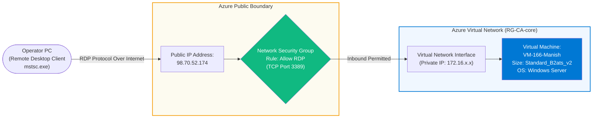

# Experiment 05: Azure Windows Virtual Machine Provisioning & Remote Desktop (RDP) Access

---

## 🎯 Aim & Objectives
To provision, configure, and connect to an enterprise-grade Windows Virtual Machine (`VM-166-Manish`) in **Microsoft Azure** using the Azure Portal, configure Network Security Group (NSG) inbound security rules for Remote Desktop Protocol (RDP port 3389), allocate a public IP address (`98.70.52.174`), and establish an authenticated interactive Remote Desktop session.

---

## 📖 Theoretical Background

In cloud infrastructure engineering:
1. **Infrastructure as a Service (IaaS)**:
   - Azure Virtual Machines offer on-demand, scalable computing resources. Users retain full administrative control over the operating system, networking stack, and installed runtimes (e.g., Self-Hosted Integration Runtime, database drivers, scripts).

2. **Burstable Compute Architecture (`B-Series`)**:
   - The `Standard_B2ats_v2` / `Standard_B2als_v2` series provides cost-effective burstable performance utilizing AMD/Intel CPU cores. It is optimized for developmental workloads, administrative jumpboxes, and hybrid integration runtimes where compute demand varies dynamically.

3. **Network Security Groups (NSGs) & Inbound Port Governance**:
   - NSGs act as virtual firewalls at the subnet or network interface (NIC) layer.
   - For secure administrative management, TCP port `3389` (Remote Desktop Protocol) is explicitly authorized in the inbound security rules to allow encrypted GUI remote desktop access from the operator's client machine.

---

## 🏗️ Architecture & Connectivity Workflow

---

## ⚙️ Virtual Machine Configuration Specifications

| Parameter Field | Configured Enterprise Value |
| :--- | :--- |
| **Virtual Machine Name** | `VM-166-Manish` |
| **Deployment Identifier** | `CreateVirtualMachine-VM-166-Manish` |
| **Student / Operator** | Yadav Manish Chandrajeet (`cal166@redalis.net`) |
| **Azure Subscription** | `JAIN-CloudAnalytics-Lab (c2135661-f8fb-457d-abac-225af670f33e)` |
| **Resource Group** | `RG-CA-core` / `RG-CA-student-vms` |
| **Operating System** | `Windows Server / Windows 64-bit` |
| **Compute Sizing Tier** | `Standard_B2ats_v2` (2 vCPUs, 1 GiB memory) |
| **Administrator Account** | `azureuser` |
| **Inbound Security Rule** | `RDP (3389)` — Enabled |
| **Public IP Address** | `98.70.52.174` |
| **Deployment Correlation ID** | `9e98bb6a-06ef-4565-8298-9731c9388c47` |
| **Validation Result** | `Deployment succeeded · Live RDP session confirmed` ✅ |

---

## 🛠️ Step-by-Step Implementation Procedure

### Step 1: Azure Virtual Machine Wizard Initialization
- Navigate to **Azure Portal** $\rightarrow$ **Virtual Machines** $\rightarrow$ **Create** $\rightarrow$ **Azure virtual machine**.
- Select subscription `JAIN-CloudAnalytics-Lab` and target resource group `RG-CA-core`.
- Specify virtual machine name: `VM-166-Manish`.

### Step 2: Sizing & Administrator Account Setup
- Select the `Standard_B2ats_v2` compute tier providing 2 vCPUs and burstable capability.
- Configure administrator credentials with username `azureuser` and a strong compliant password.

### Step 3: Configure Inbound Port Rules for RDP
- Under **Inbound port rules**, choose *Allow selected ports*.
- Select **RDP (3389)** to open administrative ingress through the virtual machine's Network Security Group.

### Step 4: Review, Validate & Deploy
- Click **Review + create** to run validation against Azure Resource Manager constraints.
- Once validation passes, click **Create**.
- Monitor the deployment progress until the notification indicates: `Deployment 'CreateVirtualMachine-VM-166-Manish' to resource group 'RG-CA-core' was successful`.

### Step 5: Establish Remote Desktop Session (RDP)
- Extract the assigned public IP address: `98.70.52.174`.
- Launch the Windows Remote Desktop Connection client (`mstsc.exe`).
- Connect to `98.70.52.174:3389` using username `azureuser`.
- Authenticate and verify desktop landing with operational Windows tools (Microsoft Edge, File Explorer).

---

## 📸 Visual Evidence (Proof of Work)

### 1. Administrator Account & Inbound Port Rules Setup
> Configuring administrator credentials (`azureuser`) and enabling public inbound port `RDP (3389)` in the Azure VM wizard.

---

### 2. Compute Sizing & Resource Group Allocation
> Sizing selection (`Standard_B2ats_v2` - 2 vCPUs, 1 GiB memory) under `RG-CA-student-vms` / `RG-CA-core`.

---

### 3. Azure Resource Manager Deployment Complete
> Successful deployment notification confirming `CreateVirtualMachine-VM-166-Manish` in `RG-CA-core`.

---

### 4. Deployment Details & Resource Overview
> Azure Portal deployment summary showing correlation ID `9e98bb6a-06ef-4565-8298-9731c9388c47`.

---

### 5. Live Interactive Remote Desktop (RDP) Session
> Successful RDP session to host `98.70.52.174` displaying the running Windows desktop environment ready for lab workloads.

---

## 📊 Results & Conclusion
- Successfully deployed Windows Virtual Machine `VM-166-Manish` in Azure resource group `RG-CA-core`.
- Verified Network Security Group rule application for TCP port 3389.
- Established and validated interactive GUI connectivity via RDP to public endpoint `98.70.52.174`.
