# Experiment 06: Hybrid Data Ingestion Pipeline Architecture — On-Prem / VM File System to ADLS Gen2 via Self-Hosted IR & Key Vault

[-blue)](https://learn.microsoft.com/en-us/azure/data-factory/create-self-hosted-integration-runtime)
[-success?logo=microsoftazure&logoColor=white)](https://azure.microsoft.com/en-us/products/storage/data-lake-storage/)

---

## 🎯 Aim & Objectives
To architect, configure, and validate an end-to-end **Hybrid Data Ingestion Pipeline** in **Azure Data Factory (`adf-jain-cloudanalytics`)**, establishing a secure File System Linked Service (`LS_Onprem_File_166`) on an Azure Windows Server node (`VM166`) via a dedicated **Self-Hosted Integration Runtime (`integrationRuntime-166`)** targeting UNC share `\\VM166\ADF_CA`, decoupled with **Azure Key Vault (`LS_keyvault_166`)**, and landing target dataset `Manish_Yadav.csv` into **Azure Data Lake Storage Gen2 (`caljainstorage1`)** container `raw` under path `raw/ingest/`.

---

## 📖 Theoretical Background

In enterprise data engineering, corporate databases, file repositories, and legacy on-premises workloads reside inside protected private subnets or on-premises data centers without direct internet routability.

### Core Architectural Components:
1. **Self-Hosted Integration Runtime (SHIR)**:
   - A dedicated agent installed on an on-premises or cloud-hosted Windows Server virtual machine (`VM166`).
   - Initiates exclusively **outbound TCP connections** (over port 443) to the Azure Data Factory control plane, eliminating the security vulnerability of opening inbound firewall ports into corporate networks.
2. **File System Connector (SMB / UNC Share)**:
   - Connects to local folders or network shares (e.g., `\\VM166\ADF_CA`) using domain or local Windows credentials (`VM166\azureuser`).
3. **Azure Key Vault Decoupling (`LS_keyvault_166`)**:
   - Manages connection secrets and storage keys centrally, adhering to Zero-Trust security principles.
4. **Data Lake Tiered Ingestion (`raw/ingest/`)**:
   - In modern Medallion / Lakehouse architectures, raw unformatted datasets are staged in a dedicated landing zone (`raw/ingest/`) before downstream validation, enrichment, and transformation into Delta or Parquet format.

---

## 🏗️ End-to-End Enterprise Architecture

```mermaid
flowchart LR
    subgraph OnPremNode ["Host Node: VM166 (Windows Server 2022)"]
        Share["UNC Local Network Share:\n\\\\VM166\\ADF_CA\n(Source Dataset: Manish_Yadav.csv)"]
        SHIR["Self-Hosted Integration Runtime:\nintegrationRuntime-166\n(Outbound TLS 443)"]
        Share --- SHIR
    end

    subgraph DataFactory ["Azure Data Factory (adf-jain-cloudanalytics)"]
        LS_File["Source Linked Service:\nLS_Onprem_File_166\n(File system)"]
        LS_KV["Security Linked Service:\nLS_keyvault_166\n(Azure Key Vault)"]
        LS_ADLS["Destination Linked Service:\nLS_adls_ingest_166\n(ADLS Gen2)"]
        Pipeline[["Ingestion Pipeline Execution"]]

        LS_File --> Pipeline
        LS_KV -.->|Fetch Credentials| Pipeline
        Pipeline --> LS_ADLS
    end

    subgraph CloudStorage ["Azure Data Lake Storage Gen2 (caljainstorage1)"]
        RawContainer[("Container: raw")]
        IngestFolder["Folder: ingest/"]
        LandedBlob["Manish_Yadav.csv\n(Size: 2.9 KiB, Hot Tier)"]

        RawContainer --> IngestFolder --> LandedBlob
    end

    SHIR -->|Secure Tunnel| LS_File
    LS_ADLS -->|Land Staged Stream| RawContainer

    style OnPremNode fill:#f9f9f9,stroke:#0078D4,stroke-width:2px;
    style DataFactory fill:#f0f7ff,stroke:#005BA1,stroke-width:2px;
    style CloudStorage fill:#e8f4fc,stroke:#008AD7,stroke-width:2px;
    style Pipeline fill:#0078D4,color:#fff;
    style LandedBlob fill:#10b981,color:#fff;
```

---

## ⚙️ Hybrid Environment & Resource Specifications

| Component / Layer | Parameter | Configured Value |
| :--- | :--- | :--- |
| **Student / Operator** | User Principal | Yadav Manish Chandrajeet (`cal166@redalis.net`) |
| **Host Node (VM)** | Virtual Machine Name | `VM166` |
| | Operating System | Windows Server 2022 Datacenter Azure Edition |
| | Compute Sizing | `Standard B2als v2` (2 vCPUs, 4 GiB memory) |
| | Deployment Region | `Central India (Zone 1)` |
| | Public / Private IP | `40.81.236.29` / `172.16.0.4` |
| | Virtual Network / Subnet | `vnet-centralindia-17` / `snet-centralindia-1` |
| **Integration Runtime** | Runtime Name | `integrationRuntime-166` |
| | Type | Self-Hosted Integration Runtime (SHIR) |
| | Status | Online / Connected ✅ |
| **Source File System** | Linked Service Name | `LS_Onprem_File_166` |
| | Host UNC Path | `\\VM166\ADF_CA` |
| | Authentication User | `VM166\azureuser` |
| | Test Connection | `Connection successful` ✅ |
| **Key Vault** | Linked Service Name | `LS_keyvault_166` |
| | Target Key Vault | `CA-KeyValt` |
| **Destination Storage** | Linked Service Name | `LS_adls_ingest_166` |
| | Storage Account | `caljainstorage1` (ADLS Gen2) |
| | Container / Folder Path | `raw/ingest/` |
| | Ingested Dataset | `Manish_Yadav.csv` (Size: `2.9 KiB`, Block blob, Hot tier) |

---

## 🛠️ Step-by-Step Implementation Procedure

### Step 1: Windows Server VM166 Host Provisioning
- Verify that compute node `VM166` is in a running state within `Central India (Zone 1)`.
- Confirm assigned network interfaces: Public IP `40.81.236.29` and Private IP `172.16.0.4`.
- Validate OS version: Windows Server 2022 Datacenter Azure Edition on `Standard B2als v2` compute.

### Step 2: Configure Shared Directory & Local Credentials
- On node `VM166`, establish an administrative shared folder named `ADF_CA` with UNC access path `\\VM166\ADF_CA`.
- Place the student source file `Manish_Yadav.csv` into the directory.
- Configure local file system permissions for user `VM166\azureuser`.

### Step 3: Register Self-Hosted Integration Runtime (`integrationRuntime-166`)
- In Azure Data Factory Studio (`adf-jain-cloudanalytics`), navigate to **Manage** $\rightarrow$ **Integration runtimes**.
- Create and register `integrationRuntime-166` using the generated authentication keys on `VM166`.
- Verify the active status and bidirectional heartbeat to the ADF control plane.

### Step 4: Configure the Linked Services Triad
- In **Manage** $\rightarrow$ **Linked services**, establish the three core integration connectors:
  1. **`LS_Onprem_File_166`**: Type *File system*, routed via `integrationRuntime-166`, targeting host `\\VM166\ADF_CA` with user `VM166\azureuser`. Execute connection test $\rightarrow$ `Connection successful`.
  2. **`LS_keyvault_166`**: Type *Azure Key Vault* for secure secret references.
  3. **`LS_adls_ingest_166`**: Type *Azure Data Lake Storage Gen2* targeting account `caljainstorage1`.

### Step 5: Execute Ingestion & Validate Destination Landing
- Trigger the pipeline data copy activity to read from `\\VM166\ADF_CA\Manish_Yadav.csv` and write to ADLS Gen2.
- Navigate to **Storage browser** in `caljainstorage1` $\rightarrow$ Blob containers $\rightarrow$ `raw` $\rightarrow$ `ingest`.
- Verify the successful arrival and schema integrity of `Manish_Yadav.csv`.

---

## 📸 Visual Evidence (Proof of Work)

### 1. Azure Windows Server VM166 Host Overview
> Enterprise virtual machine `VM166` running Windows Server 2022 Datacenter in Central India, serving as the Self-Hosted Integration Runtime host node.

---

### 2. Azure Data Factory Triad Linked Services Configuration & Successful Handshake
> Configuration panel for `LS_Onprem_File_166` routing through `integrationRuntime-166` to `\\VM166\ADF_CA` with verified connection status alongside `LS_adls_ingest_166` and `LS_keyvault_166`.

---

### 3. ADLS Gen2 Storage Browser Landing Verification (`raw/ingest/Manish_Yadav.csv`)
> Azure Portal Storage Browser confirming that `Manish_Yadav.csv` (Size: `2.9 KiB`, Hot tier, Block blob) has successfully landed in container `raw` under folder path `raw/ingest/`.

---

## 📊 Results & Conclusion
- Built and validated a production-ready hybrid ingestion architecture bridging on-premises/VM file systems to Azure cloud data lakes.
- Successfully routed data through **Self-Hosted Integration Runtime (`integrationRuntime-166`)** without exposing inbound public firewall ports.
- Confirmed full dataset staging of `Manish_Yadav.csv` into Azure Data Lake Storage Gen2 container `raw/ingest/`.
