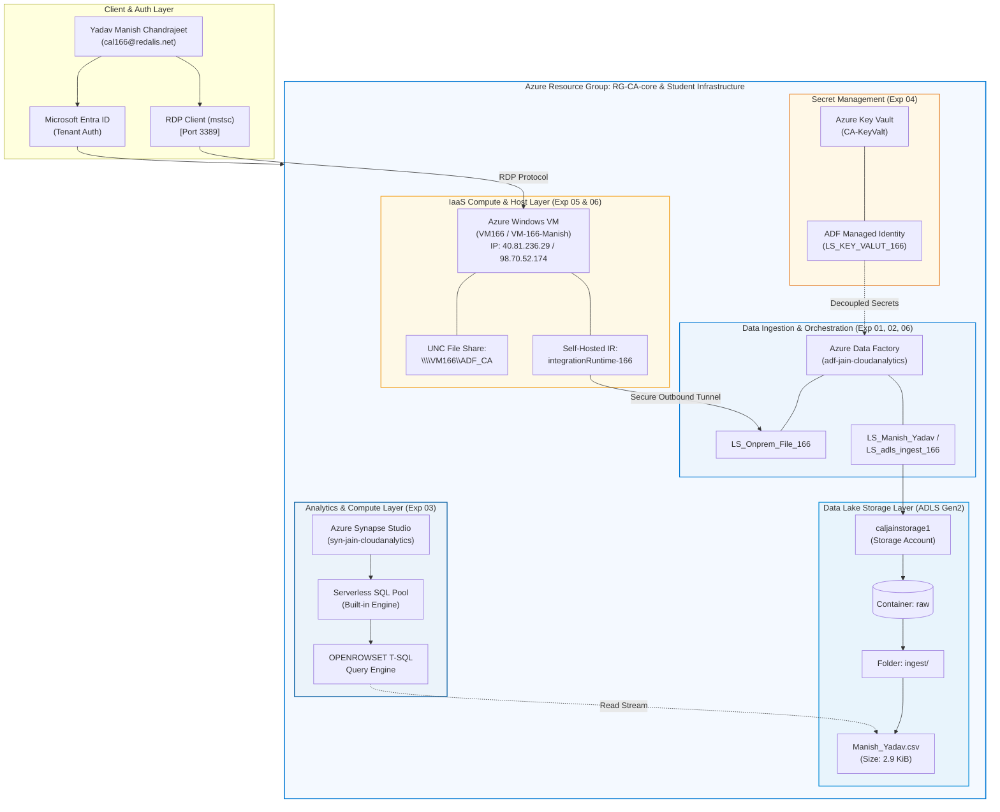

# ☁️ Azure Cloud Analytics Lab — Proof of Work (Semester 3)

[](https://azure.microsoft.com/)
[](https://azure.microsoft.com/en-us/products/data-factory/)
[](https://azure.microsoft.com/en-us/products/synapse-analytics/)
[](https://www.jainuniversity.ac.in/)

---

## 👤 Student & Lab Information

| Attribute | Details |
| :--- | :--- |
| **Student Name** | **Yadav Manish Chandrajeet** |
| **User Principal / Login** | `cal166@redalis.net` |
| **GitHub Profile** | [`sudo-su-wakeup`](https://github.com/sudo-su-wakeup) |
| **Academic Program** | Semester 3 — Cloud Analytics Lab Exercises |
| **Institution** | Jain University |
| **Azure Subscription** | `JAIN-CloudAnalytics-Lab` (`c2135661-f8fb-457d-abac-225af670f33e`) |
| **Resource Group** | `RG-CA-core` |
| **Primary Region** | `South India` |

---

## 📚 Executive Summary & Table of Contents

This repository represents the comprehensive **Proof-of-Work (PoW)** portfolio for the Microsoft Azure Cloud Analytics laboratory curriculum. It documents cloud resource provisioning, data integration pipelines, linked service configurations, serverless Transact-SQL analytics, and cloud security / RBAC troubleshooting.

| Experiment | Title | Key Cloud Services | Documentation File | Verification Status |
| :---: | :--- | :--- | :---: | :---: |
| **Exp 01** | **ADF Pipeline: On-Prem SQL / Ingestion to Blob Storage** | Azure Data Factory V2, ADLS Gen2, Resource Groups | [📄 EXPERIMENT-01.md](./EXPERIMENT-01.md) | `Completed` ✅ |
| **Exp 02** | **Linked Service Configuration to ADLS Gen2** | Integration Runtime, Linked Services, Storage Keys | [📄 EXPERIMENT-02.md](./EXPERIMENT-02.md) | `Completed` ✅ |
| **Exp 03** | **Serverless SQL Analytics & Synapse RBAC Diagnostics** | Azure Synapse Analytics, Serverless SQL (`OPENROWSET`), RBAC | [📄 EXPERIMENT-03.md](./EXPERIMENT-03.md) | `Completed` ✅ |
| **Exp 04** | **Azure Key Vault Linked Service & Managed Identity** | Azure Key Vault (`CA-KeyValt`), Azure Data Factory, SAMI | [📄 EXPERIMENT-04.md](./EXPERIMENT-04.md) | `Completed` ✅ |
| **Exp 05** | **Azure Windows Virtual Machine Provisioning & RDP Access** | Azure Compute, Windows Server, NSG Inbound (RDP 3389) | [📄 EXPERIMENT-05.md](./EXPERIMENT-05.md) | `Completed` ✅ |
| **Exp 06** | **Hybrid Ingestion Pipeline (VM File System to ADLS Gen2)** | Self-Hosted IR (`integrationRuntime-166`), Windows VM, Key Vault, ADLS Gen2 (`raw/ingest`) | [📄 EXPERIMENT-06.md](./EXPERIMENT-06.md) | `Completed` ✅ |

---

## 🏗️ End-to-End Enterprise Architecture



---

## 📁 Repository Directory Structure

```
.
├── .gitignore                                 # Git ignore configuration
├── README.md                                  # Master Proof-of-Work Portfolio (This File)
├── EXPERIMENT-01.md                           # Experiment 1: Ingestion & ADF Provisioning
├── EXPERIMENT-02.md                           # Experiment 2: Linked Service to ADLS Gen2
├── EXPERIMENT-03.md                           # Experiment 3: Serverless SQL & RBAC Analysis
├── EXPERIMENT-04.md                           # Experiment 4: Azure Key Vault & Managed Identity
├── EXPERIMENT-05.md                           # Experiment 5: Windows VM Provisioning & RDP Access
├── EXPERIMENT-06.md                           # Experiment 6: Hybrid Ingestion Pipeline (VM to ADLS Gen2)
├── Experiment 1.pdf                           # Original Lab Manual / Exercise Reference
└── Screenshots/                               # Master Proof-of-Work Screenshot Evidence
    ├── Experiment-01/
    │   ├── 01_Account_login_successful.png    # Azure Tenant Authentication
    │   ├── 02_Resource_group.png              # Resource Group RG-CA-core Overview
    │   ├── 03_ADF_Overview.png                # Azure Data Factory Studio
    │   └── 04_Raw_data_Blob_Container.png     # Raw Data Ingestion (Manish_Yadav.csv)
    ├── Experiment-02/
    │   └── 01_Test_connection_successful.png  # Linked Service Test Connection Validation
    ├── Experiment-03/
    │   ├── 01_Synapse_Analytics_Explorer.png  # Synapse Studio Data Explorer
    │   ├── 02_Serverless_SQL_Script_Query.png # Serverless OPENROWSET SQL Script
    │   └── 03_Synapse_403_Access_Error.png    # Synapse 403 Forbidden RBAC Diagnostics
    ├── EXP04/
    │   ├── Screenshot 2026-08-17 151643.png   # Key Vault LS_KEY_VALUT_166 Connection Test
    │   ├── Screenshot 2026-08-17 151712.png   # Key Vault Linked Service Catalog Registration
    │   └── Screenshot 2026-08-17 152552.png   # Full Active Linked Services Inventory
    ├── Exp05/
    │   ├── Screenshot 2026-08-17 151658.png   # Linked Services Baseline Check
    │   ├── Screenshot 2026-08-17 153118.png   # Admin Account & Inbound RDP (3389) Config
    │   ├── Screenshot 2026-08-17 153236.png   # VM Compute Sizing Selection (Standard_B2ats_v2)
    │   ├── Screenshot 2026-08-17 153908.png   # VM Deployment Succeeded Confirmation
    │   ├── Screenshot 2026-08-17 154041.png   # ARM Deployment Resource Details
    │   └── Screenshot 2026-08-17 154816.png   # Live Interactive Remote Desktop Connection
    └── Exp06/
        ├── Azure VM166 Portal Overview.png    # Windows Server VM166 Host Overview
        ├── Azure Data Factory Linked Services Configuration.png # File System LS via Self-Hosted IR
        └── Azure Blob List with Selected Manish_Yadav.csv.png   # Landed Dataset in raw/ingest
```

---

## 🧪 Experiments Summary

### [Experiment 01: ADF Pipeline & Ingestion to Azure Blob Storage](./EXPERIMENT-01.md)
- **Focus**: Enterprise cloud tenant authentication, resource group deployment (`RG-CA-core`), Azure Data Factory instance (`adf-jain-cloudanalytics`), and raw CSV data ingestion (`Manish_Yadav.csv`) into ADLS Gen2 storage container (`raw`).
- **Highlights**:
  - Verification of Microsoft Entra identity (`Yadav Manish Chandrajeet`).
  - Architecture overview across South India deployment region.
  - Ingested dataset validation in `caljainstorage1`.

### [Experiment 02: Linked Service Configuration to ADLS Gen2](./EXPERIMENT-02.md)
- **Focus**: Establishing secure connection protocols between Azure Data Factory / Synapse compute and Azure Data Lake Storage Gen2.
- **Highlights**:
  - Configured Linked Service `LS_Manish_Yadav`.
  - Connected via `AutoResolveIntegrationRuntime` with Account Key authentication.
  - Successfully verified end-to-end network and security handshake.

### [Experiment 03: Serverless SQL Analytics & Security Diagnostics in Azure Synapse](./EXPERIMENT-03.md)
- **Focus**: Querying data lake datasets using the Synapse `Built-in` Serverless SQL pool via `OPENROWSET` Transact-SQL, coupled with an in-depth security diagnostic.
- **Highlights**:
  - Auto-generated and configured `OPENROWSET` query targeting `raw/Manish_Yadav.csv`.
  - Root Cause Analysis (RCA) on HTTP Error 403 (Forbidden) and Built-in SQL pool role delegation.
  - Complete enterprise remediation protocol outlining Synapse RBAC and Azure Storage IAM role assignments.

### [Experiment 04: Azure Key Vault Linked Service & Managed Identity Integration](./EXPERIMENT-04.md)
- **Focus**: Implementing centralized secret management and credential decoupling in Azure Data Factory.
- **Highlights**:
  - Configured Linked Service `LS_KEY_VALUT_166` targeting Azure Key Vault `CA-KeyValt`.
  - Implemented **System-Assigned Managed Identity** authentication (`Object ID: 3ae82b19-52a2-4af8-829e-c91f3036335a`).
  - Verified zero-trust token exchange and validated `Connection successful`.

### [Experiment 05: Azure Windows Virtual Machine Provisioning & RDP Access](./EXPERIMENT-05.md)
- **Focus**: Deploying cloud IaaS compute infrastructure with network security group ingress rules for remote administrative access.
- **Highlights**:
  - Provisioned Windows Virtual Machine `VM-166-Manish` (`Standard_B2ats_v2`, 2 vCPUs, 1 GiB RAM).
  - Configured NSG inbound firewall rules permitting TCP port `3389` (RDP).
  - Established and verified live interactive Remote Desktop session via public IP `98.70.52.174`.

### [Experiment 06: Hybrid Ingestion Pipeline Architecture (VM File System to ADLS Gen2)](./EXPERIMENT-06.md)
- **Focus**: Architecting an end-to-end hybrid data movement pipeline transferring files from a local network share to Azure Data Lake Storage Gen2.
- **Highlights**:
  - Connected to Windows Server host `VM166` (Central India, IP: `40.81.236.29` / `172.16.0.4`).
  - Configured File System Linked Service `LS_Onprem_File_166` via **Self-Hosted Integration Runtime (`integrationRuntime-166`)** targeting `\\VM166\ADF_CA`.
  - Decoupled secrets with Azure Key Vault (`LS_keyvault_166`) and verified landing of `Manish_Yadav.csv` in `raw/ingest/`.

---

## 🚀 Connecting and Pushing this Repository to GitHub

To publish this repository to your GitHub account:

### Step 1: Create a New Repository on GitHub
1. Open your browser and navigate to [github.com/new](https://github.com/new).
2. Repository Name: `Azure-Cloud-Analytics-Lab` (or your preferred name).
3. Set Visibility: **Public** or **Private**.
4. Leave *"Initialize this repository with a README"* **unchecked** (since we already have a full repository built).
5. Click **Create repository**.

### Step 2: Push Local Repository to GitHub
Open PowerShell or your terminal in this project folder and run:

```powershell
# 1. Add your GitHub repository as the remote origin
git remote add origin https://github.com/sudo-su-wakeup/<YOUR_REPOSITORY_NAME>.git

# 2. Rename branch to main (if not already main)
git branch -M main

# 3. Push code and documentation to GitHub
git push -u origin main
```

---

## 📜 Academic Integrity & License
This laboratory repository is authored by **Yadav Manish Chandrajeet** for the **Sem-3 Cloud Analytics Course** at **Jain University**. All work and visual proofs represent genuine hands-on lab exercises executed on the Microsoft Azure cloud platform.
