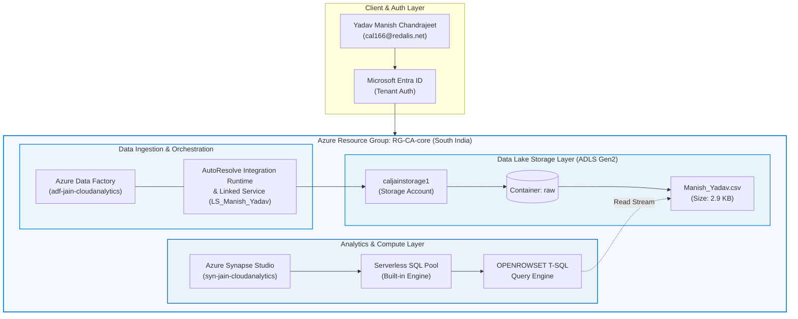

# ☁️ Azure Cloud Analytics Lab — Proof of Work (Semester 3)

[](https://azure.microsoft.com/)
[](https://azure.microsoft.com/en-us/products/data-factory/)
[](https://azure.microsoft.com/en-us/products/synapse-analytics/)
[](https://www.jainuniversity.ac.in/)

---

## 👤 Student & Lab Information

| Attribute | Details |
| :--- | :--- |
| **Student Name** | **Yadav Manish Chandrajeet** |
| **User Principal / Login** | `cal166@redalis.net` |
| **GitHub Profile** | [`sudo-su-wakeup`](https://github.com/sudo-su-wakeup) |
| **Academic Program** | Semester 3 — Cloud Analytics Lab Exercises |
| **Institution** | Jain University |
| **Azure Subscription** | `JAIN-CloudAnalytics-Lab` (`c2135661-f8fb-457d-abac-225af670f33e`) |
| **Resource Group** | `RG-CA-core` |
| **Primary Region** | `South India` |

---

## 📚 Executive Summary & Table of Contents

This repository represents the comprehensive **Proof-of-Work (PoW)** portfolio for the Microsoft Azure Cloud Analytics laboratory curriculum. It documents cloud resource provisioning, data integration pipelines, linked service configurations, serverless Transact-SQL analytics, and cloud security / RBAC troubleshooting.

| Experiment | Title | Key Cloud Services | Documentation File | Verification Status |
| :---: | :--- | :--- | :---: | :---: |
| **Exp 01** | **ADF Pipeline: On-Prem SQL / Ingestion to Blob Storage** | Azure Data Factory V2, ADLS Gen2, Resource Groups | [📄 EXPERIMENT-01.md](./EXPERIMENT-01.md) | `Completed` ✅ |
| **Exp 02** | **Linked Service Configuration to ADLS Gen2** | Integration Runtime, Linked Services, Storage Keys | [📄 EXPERIMENT-02.md](./EXPERIMENT-02.md) | `Completed` ✅ |
| **Exp 03** | **Serverless SQL Analytics & Synapse RBAC Diagnostics** | Azure Synapse Analytics, Serverless SQL (`OPENROWSET`), RBAC | [📄 EXPERIMENT-03.md](./EXPERIMENT-03.md) | `Completed` ✅ |

---

## 🏗️ End-to-End Enterprise Architecture



---

## 📁 Repository Directory Structure

```
.
├── .gitignore                                 # Git ignore configuration
├── README.md                                  # Master Proof-of-Work Portfolio (This File)
├── EXPERIMENT-01.md                           # Experiment 1: Ingestion & ADF Provisioning
├── EXPERIMENT-02.md                           # Experiment 2: Linked Service to ADLS Gen2
├── EXPERIMENT-03.md                           # Experiment 3: Serverless SQL & RBAC Analysis
├── Experiment 1.pdf                           # Original Lab Manual / Exercise Reference
└── Screenshots/                               # Master Proof-of-Work Screenshot Evidence
    ├── Experiment-01/
    │   ├── 01_Account_login_successful.png    # Azure Tenant Authentication
    │   ├── 02_Resource_group.png              # Resource Group RG-CA-core Overview
    │   ├── 03_ADF_Overview.png                # Azure Data Factory Studio
    │   └── 04_Raw_data_Blob_Container.png     # Raw Data Ingestion (Manish_Yadav.csv)
    ├── Experiment-02/
    │   └── 01_Test_connection_successful.png  # Linked Service Test Connection Validation
    └── Experiment-03/
        ├── 01_Synapse_Analytics_Explorer.png  # Synapse Studio Data Explorer
        ├── 02_Serverless_SQL_Script_Query.png # Serverless OPENROWSET SQL Script
        └── 03_Synapse_403_Access_Error.png    # Synapse 403 Forbidden RBAC Diagnostics
```

---

## 🧪 Experiments Summary

### [Experiment 01: ADF Pipeline & Ingestion to Azure Blob Storage](./EXPERIMENT-01.md)
- **Focus**: Enterprise cloud tenant authentication, resource group deployment (`RG-CA-core`), Azure Data Factory instance (`adf-jain-cloudanalytics`), and raw CSV data ingestion (`Manish_Yadav.csv`) into ADLS Gen2 storage container (`raw`).
- **Highlights**:
  - Verification of Microsoft Entra identity (`Yadav Manish Chandrajeet`).
  - Architecture overview across South India deployment region.
  - Ingested dataset validation in `caljainstorage1`.

### [Experiment 02: Linked Service Configuration to ADLS Gen2](./EXPERIMENT-02.md)
- **Focus**: Establishing secure connection protocols between Azure Data Factory / Synapse compute and Azure Data Lake Storage Gen2.
- **Highlights**:
  - Configured Linked Service `LS_Manish_Yadav`.
  - Connected via `AutoResolveIntegrationRuntime` with Account Key authentication.
  - Successfully verified end-to-end network and security handshake.

### [Experiment 03: Serverless SQL Analytics & Security Diagnostics in Azure Synapse](./EXPERIMENT-03.md)
- **Focus**: Querying data lake datasets using the Synapse `Built-in` Serverless SQL pool via `OPENROWSET` Transact-SQL, coupled with an in-depth security diagnostic.
- **Highlights**:
  - Auto-generated and configured `OPENROWSET` query targeting `raw/Manish_Yadav.csv`.
  - Root Cause Analysis (RCA) on HTTP Error 403 (Forbidden) and Built-in SQL pool role delegation.
  - Complete enterprise remediation protocol outlining Synapse RBAC and Azure Storage IAM role assignments.

---

## 🚀 Connecting and Pushing this Repository to GitHub

To publish this repository to your GitHub account:

### Step 1: Create a New Repository on GitHub
1. Open your browser and navigate to [github.com/new](https://github.com/new).
2. Repository Name: `Azure-Cloud-Analytics-Lab` (or your preferred name).
3. Set Visibility: **Public** or **Private**.
4. Leave *"Initialize this repository with a README"* **unchecked** (since we already have a full repository built).
5. Click **Create repository**.

### Step 2: Push Local Repository to GitHub
Open PowerShell or your terminal in this project folder and run:

```powershell
# 1. Add your GitHub repository as the remote origin
git remote add origin https://github.com/sudo-su-wakeup/<YOUR_REPOSITORY_NAME>.git

# 2. Rename branch to main (if not already main)
git branch -M main

# 3. Push code and documentation to GitHub
git push -u origin main
```

---

## 📜 Academic Integrity & License
This laboratory repository is authored by **Yadav Manish Chandrajeet** for the **Sem-3 Cloud Analytics Course** at **Jain University**. All work and visual proofs represent genuine hands-on lab exercises executed on the Microsoft Azure cloud platform.
